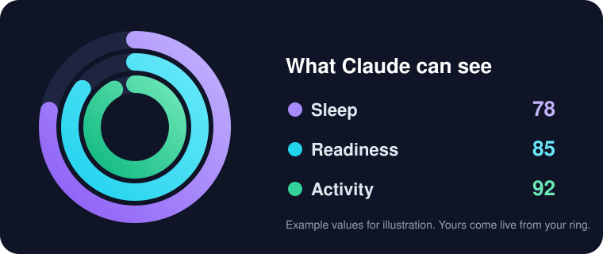
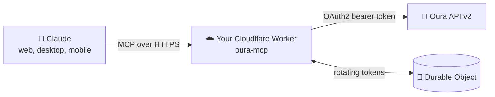

<div align="center">



<br>

A remote [MCP](https://modelcontextprotocol.io) server that plugs your **Oura Ring** data into Claude, running on **Cloudflare Workers**.
No laptop left on. No server to babysit. Free to host.

[](https://deploy.workers.cloudflare.com/?url=https://github.com/mehmetaktug/oura-mcp)


</div>

---

## ✨ What you get

> *"How did I sleep this week, and what is dragging my readiness down?"*

Ask in plain language. Claude pulls the numbers straight from your ring and answers.

<div align="center">

</div>

| 🗣️ You ask | 🔍 It reads |
|---|---|
| "Show my sleep and readiness for the last 7 days" | `daily_sleep`, `daily_readiness` |
| "Is my HRV trending up or down this month?" | `sleep` |
| "Did that late workout hurt my sleep?" | `workout`, `daily_sleep` |
| "What was my resting heart rate last night?" | `sleep`, `heartrate` |
| "How stressed was I on Monday?" | `daily_stress` |
| "What is my VO2 max and cardiovascular age?" | `vO2_max`, `daily_cardiovascular_age` |
| "How much battery does my ring have left?" | `ring_battery_level` |

## 🧠 How it works



- 🏠 **Your own deployment.** It runs in *your* Cloudflare account with *your* Oura API app. Your health data never passes through anyone else's server.
- 🔒 **Read only.** The server never writes anything to your Oura account.
- 🔁 **Safe token rotation.** Oura refresh tokens are single use. One Durable Object rotates them, so concurrent requests cannot break your login.
- 🧰 **One tool, 19 collections.** `oura_data` covers everything below.

<details>
<summary><b>📚 All supported collections</b></summary>

| Group | Collections |
|---|---|
| 😴 Sleep | `daily_sleep`, `sleep`, `sleep_time`, `rest_mode_period` |
| ⚡ Readiness and stress | `daily_readiness`, `daily_stress`, `daily_resilience` |
| 🏃 Activity | `daily_activity`, `workout`, `session` |
| ❤️ Heart and body | `heartrate`, `daily_spo2`, `daily_cardiovascular_age`, `vO2_max` |
| 🏷️ Context | `tag`, `enhanced_tag` |
| 💍 Device and profile | `ring_configuration`, `ring_battery_level`, `personal_info` |

Daily collections take `start_date` and `end_date`. Time series (`heartrate`, `ring_battery_level`) take `start_datetime` and `end_datetime`. Any record can be fetched with `document_id`, and large results page with `next_token`.

</details>

## 🚀 Setup in 6 steps

**You need:** a free [Cloudflare](https://dash.cloudflare.com/sign-up) account, an Oura account, and Node.js 18 or newer.

**1. Create an Oura API app** at [developer.ouraring.com](https://developer.ouraring.com). You will add the redirect URI in step 4.

**2. Deploy** (or use the button above)

```sh
git clone https://github.com/mehmetaktug/oura-mcp && cd oura-mcp
npm install
npx wrangler login
npx wrangler deploy
```

Wrangler prints your URL, for example `https://oura-mcp.<your-subdomain>.workers.dev`.

**3. Set your secrets**

```sh
npx wrangler secret put OURA_CLIENT_ID
npx wrangler secret put OURA_CLIENT_SECRET
npx wrangler secret put MCP_SECRET     # long random string: openssl rand -hex 24
```

**4. Add the redirect URI** to your Oura app:

```
https://<your-worker-host>/callback
```

**5. Connect your ring.** Open this in a browser and approve access:

```
https://<your-worker-host>/<MCP_SECRET>/login
```

**6. Add the connector.** In claude.ai open **Settings → Connectors → Add custom connector**, paste the URL below and choose **No sign-in**:

```
https://<your-worker-host>/<MCP_SECRET>/mcp
```

That is it. Start a new chat and ask about your sleep. 🎉

## 🛡️ Security model

| | |
|---|---|
| 🔑 **Secret URL** | The path contains `MCP_SECRET`. Anyone who knows the full URL can read your Oura data, so treat it like a password. Every other path returns `404`. |
| 🔄 **Rotate anytime** | Run `npx wrangler secret put MCP_SECRET` with a new value and update your connector. |
| 🧱 **Want more?** | Put the Worker behind [Cloudflare Access](https://developers.cloudflare.com/cloudflare-one/policies/access/) for real authentication. |
| 👀 **Read only** | No tool can modify your Oura account. |

## 🧪 Local development

```sh
cp .dev.vars.example .dev.vars   # fill in the values
npx wrangler dev
```

Use `http://localhost:8787/callback` as an extra redirect URI in your Oura app while testing.

## 🩹 Troubleshooting

| Symptom | Fix |
|---|---|
| `Not connected to Oura yet` | Do step 5 once. |
| `token refresh failed` | Your Oura access was revoked or expired. Repeat step 5. |
| Oura shows `400 invalid_request` | The redirect URI in your Oura app must match `https://<your-worker-host>/callback` exactly. |
| Want your own domain | Add a `routes` entry with `custom_domain: true` to `wrangler.jsonc`. |

## 🗺️ Ideas for contributions

- Smart analysis tools: sleep debt, HRV trends, period comparisons
- Optional API key header authentication
- Webhook support for push updates
- Response trimming for token efficiency

PRs and issues are welcome. ⭐ If this is useful to you, a star helps others find it.

## ⚖️ Disclaimer

Unofficial community project. Not affiliated with or endorsed by Oura. Your data is yours: use at your own risk and never share your secret URL.

You run your own copy with your own Oura API app, so you are responsible for following the [Oura API and MCP Agreement](https://cloud.ouraring.com/legal/api-agreement) and applicable privacy laws.

## 📄 License

[MIT](LICENSE)
